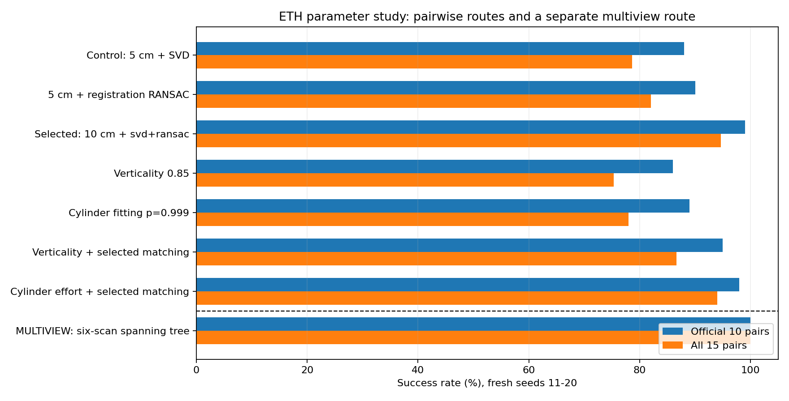
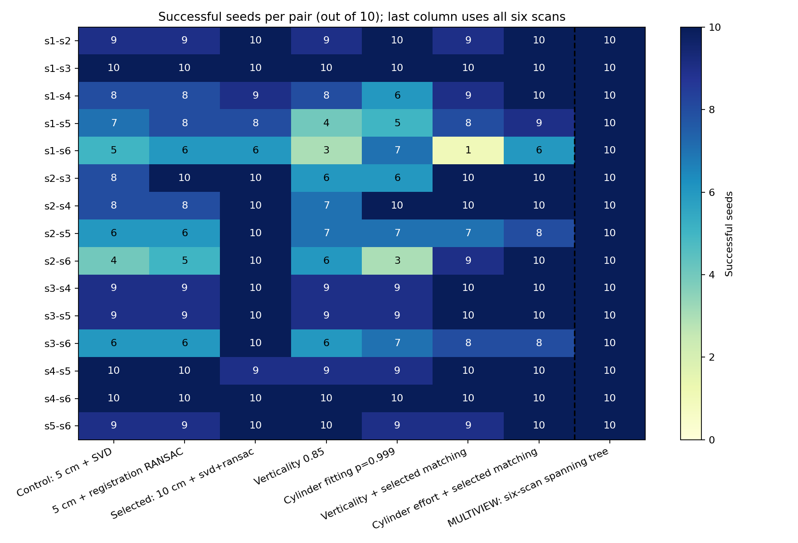

# ETH Trees 改進路徑比較

固定原本最佳擷取設定（improved、clustering 20 cm、step）；原始程式預設值保持不變。
參數在既有 seed 1–5 上篩選，6–10 只作穩定性檢查；下表使用新擷取的 seed 11–20。所有資料仍來自同一片 ETH 森林，不能當成獨立森林驗證。
成功標準固定為旋轉誤差 < 2° 且平移誤差 < 0.5 m。每個 seed 為 15 個單向配對，另列官方 10 對；原始逐對數據含失敗案例。
配準參數固定選擇：`{'name': 'threshold100', 'threshold': 0.1}`，solver=`svd+ransac`；在看新 seed 結果以前已保存於 frozen_matching.json。

| 路徑 | solver | 官方10對 | 全15對 | 每seed成功對數 | Δ對數/seed | 成功案例 e_p 中位數(m) | seed勝/負/同 | 校正p |
|---|---|---:|---:|---:|---:|---:|---:|---:|
| fresh_control | svd | 88% | 78.7% | 11.8 ± 1.6 | +0.0 | 0.0703 | 0/0/10 | 1.0000 |
| fresh_control | svd+ransac | 90% | 82.0% | 12.3 ± 1.5 | +0.5 | 0.0726 | 4/0/6 | 1.0000 |
| fresh_matching | svd | 97% | 90.0% | 13.5 ± 1.3 | +1.7 | 0.0788 | 8/0/2 | 0.0938 |
| fresh_matching | svd+ransac | 99% | 94.7% | 14.2 ± 0.6 | +2.4 | 0.0702 | 9/0/1 | 0.0469 |
| fresh_vertical085 | svd | 86% | 75.3% | 11.3 ± 1.8 | -0.5 | 0.0818 | 3/5/2 | 1.0000 |
| fresh_vertical085 | svd+ransac | 88% | 76.7% | 11.5 ± 1.8 | -0.3 | 0.0774 | 4/6/0 | 1.0000 |
| fresh_vertical085_matching | svd | 96% | 87.3% | 13.1 ± 1.0 | +1.3 | 0.0718 | 7/3/0 | 1.0000 |
| fresh_vertical085_matching | svd+ransac | 95% | 86.7% | 13.0 ± 0.9 | +1.2 | 0.0656 | 7/2/1 | 1.0000 |
| fresh_ransac999 | svd | 89% | 78.0% | 11.7 ± 1.3 | -0.1 | 0.0743 | 5/4/1 | 1.0000 |
| fresh_ransac999 | svd+ransac | 93% | 81.3% | 12.2 ± 0.9 | +0.4 | 0.0758 | 6/4/0 | 1.0000 |
| fresh_ransac999_matching | svd | 97% | 92.0% | 13.8 ± 0.8 | +2.0 | 0.0749 | 10/0/0 | 0.0234 |
| fresh_ransac999_matching | svd+ransac | 98% | 94.0% | 14.1 ± 0.6 | +2.3 | 0.0682 | 10/0/0 | 0.0234 |
| graph_mst | graph_mst | 100% | 100.0% | 15.0 ± 0.0 | +3.2 | 0.0719 | 10/0/0 | 0.0234 |

## 共同成功案例的精度

只比較此方法與control SVD都成功的相同(seed,pair)，避免將不同成功集合的中位數當成精度改善。

| 方法 | solver | 共同成功筆數 | control e_p中位數(m) | 此方法e_p中位數(m) |
|---|---|---:|---:|---:|
| fresh_control | svd | 118 | 0.0703 | 0.0703 |
| fresh_control | svd+ransac | 118 | 0.0703 | 0.0713 |
| fresh_matching | svd | 110 | 0.0696 | 0.0725 |
| fresh_matching | svd+ransac | 111 | 0.0699 | 0.0661 |
| fresh_vertical085 | svd | 90 | 0.0692 | 0.0780 |
| fresh_vertical085 | svd+ransac | 92 | 0.0686 | 0.0718 |
| fresh_vertical085_matching | svd | 104 | 0.0703 | 0.0718 |
| fresh_vertical085_matching | svd+ransac | 103 | 0.0694 | 0.0629 |
| fresh_ransac999 | svd | 101 | 0.0699 | 0.0743 |
| fresh_ransac999 | svd+ransac | 104 | 0.0703 | 0.0758 |
| fresh_ransac999_matching | svd | 114 | 0.0699 | 0.0718 |
| fresh_ransac999_matching | svd+ransac | 114 | 0.0699 | 0.0660 |
| graph_mst | graph_mst | 118 | 0.0703 | 0.0696 |

## 既有 seed 的篩選結果

選擇只依seed 1–5；6–10沒有參與本次參數選擇。原本20 cm設定已在ETH上挑選，因此兩組都不能稱為獨立森林測試。

| 設定 | solver | seed1–5 成功/75 | seed6–10 成功/75 |
|---|---|---:|---:|
| control | svd | 63 | 63 |
| control | svd+ransac | 61 | 65 |
| threshold075 | svd | 64 | 62 |
| threshold075 | svd+ransac | 67 | 65 |
| threshold100 | svd | 68 | 67 |
| threshold100 | svd+ransac | 70 | 69 |
| score20 | svd | 62 | 59 |
| score20 | svd+ransac | 63 | 63 |
| score60 | svd | 52 | 57 |
| score60 | svd+ransac | 50 | 57 |
| min_dc4 | svd | 62 | 64 |
| min_dc4 | svd+ransac | 60 | 65 |
| sectors93 | svd | 58 | 54 |
| sectors93 | svd+ransac | 57 | 58 |
| merge015 | svd | 60 | 63 |
| merge015 | svd+ransac | 60 | 64 |
| merge030 | svd | 58 | 63 |
| merge030 | svd+ransac | 58 | 65 |

## 路徑差異

- `fresh_control`：新 seed 的原本最佳設定，5 cm；同時列 SVD 與 SVD+RANSAC，供既有 solver 對照。
- `fresh_matching`：只修改配準參數；10 cm 等非 5 cm 設定皆是我們的敏感度實驗，不是論文原設定。
- `fresh_vertical085`：verticality 0.90 → 0.85；增加可見樹幹點，仍用 5 cm 配準。
- `fresh_ransac999`：圓柱擬合迭代上限 1000 → 3000，成功機率 0.99 → 0.999；仍用 5 cm 配準。
- 名稱後綴 `_matching`：擷取變體加上預先固定的配準參數。這兩個組合在新seed配準前即列入計畫，檢查擷取與匹配改善能否相加。
- `graph_mst`：六站多視角流程。從 control 的兩站 SVD 建邊，只用估計變換後的三維互為最近鄰與匹配數決定品質；至少4個CN匹配、6個3D支持點，支持點距離 < 0.30 m、中位殘差 ≤ 0.15 m。建立最大生成森林，再沿唯一路徑串接完整6DOF變換。無路徑即失敗。選邊不讀GT。
- 圖路徑依賴中間站，與獨立兩站配準的輸入條件不同，不能將其數字直接當作超越論文的證據。沒有使用4DOF或ICP。
- e_p 均使用 source 點雲的所有點；圖路徑以分塊 NumPy 計算，已與同一筆 C++ 結果比對。中位數只對成功案例，會有成功集合不同的影響。
- seed勝/負/同：比較每個seed成功對數與control SVD；符號檢定以10個seed為單位，Bonferroni涵蓋表中所有非control比較。這只反映本場景的亂數敏感度，不提供跨森林的不確定性。

## 失敗配對

| pair | fresh_control/svd | fresh_control/svd+ransac | fresh_matching/svd | fresh_matching/svd+ransac | fresh_vertical085/svd | fresh_vertical085/svd+ransac | fresh_vertical085_matching/svd | fresh_vertical085_matching/svd+ransac | fresh_ransac999/svd | fresh_ransac999/svd+ransac | fresh_ransac999_matching/svd | fresh_ransac999_matching/svd+ransac | graph_mst/graph_mst |
|---|---|---|---|---|---|---|---|---|---|---|---|---|---|
| s1-s2 | 9/10 | 9/10 | 10/10 | 10/10 | 9/10 | 9/10 | 10/10 | 9/10 | 10/10 | 10/10 | 10/10 | 10/10 | 10/10 |
| s1-s3 | 10/10 | 10/10 | 10/10 | 10/10 | 10/10 | 10/10 | 10/10 | 10/10 | 10/10 | 10/10 | 10/10 | 10/10 | 10/10 |
| s1-s4 | 8/10 | 8/10 | 9/10 | 9/10 | 8/10 | 8/10 | 9/10 | 9/10 | 6/10 | 6/10 | 10/10 | 10/10 | 10/10 |
| s1-s5 | 7/10 | 8/10 | 8/10 | 8/10 | 4/10 | 4/10 | 10/10 | 8/10 | 5/10 | 6/10 | 9/10 | 9/10 | 10/10 |
| s1-s6 | 5/10 | 6/10 | 5/10 | 6/10 | 3/10 | 3/10 | 2/10 | 1/10 | 7/10 | 8/10 | 6/10 | 6/10 | 10/10 |
| s2-s3 | 8/10 | 10/10 | 8/10 | 10/10 | 6/10 | 8/10 | 10/10 | 10/10 | 6/10 | 9/10 | 9/10 | 10/10 | 10/10 |
| s2-s4 | 8/10 | 8/10 | 10/10 | 10/10 | 7/10 | 7/10 | 10/10 | 10/10 | 10/10 | 10/10 | 10/10 | 10/10 | 10/10 |
| s2-s5 | 6/10 | 6/10 | 10/10 | 10/10 | 7/10 | 7/10 | 7/10 | 7/10 | 7/10 | 7/10 | 8/10 | 8/10 | 10/10 |
| s2-s6 | 4/10 | 5/10 | 6/10 | 10/10 | 6/10 | 6/10 | 6/10 | 9/10 | 3/10 | 3/10 | 8/10 | 10/10 | 10/10 |
| s3-s4 | 9/10 | 9/10 | 10/10 | 10/10 | 9/10 | 9/10 | 10/10 | 10/10 | 9/10 | 9/10 | 10/10 | 10/10 | 10/10 |
| s3-s5 | 9/10 | 9/10 | 10/10 | 10/10 | 9/10 | 9/10 | 10/10 | 10/10 | 9/10 | 9/10 | 10/10 | 10/10 | 10/10 |
| s3-s6 | 6/10 | 6/10 | 10/10 | 10/10 | 6/10 | 6/10 | 8/10 | 8/10 | 7/10 | 6/10 | 8/10 | 8/10 | 10/10 |
| s4-s5 | 10/10 | 10/10 | 9/10 | 9/10 | 9/10 | 9/10 | 10/10 | 10/10 | 9/10 | 9/10 | 10/10 | 10/10 | 10/10 |
| s4-s6 | 10/10 | 10/10 | 10/10 | 10/10 | 10/10 | 10/10 | 10/10 | 10/10 | 10/10 | 10/10 | 10/10 | 10/10 | 10/10 |
| s5-s6 | 9/10 | 9/10 | 10/10 | 10/10 | 10/10 | 10/10 | 9/10 | 9/10 | 9/10 | 10/10 | 10/10 | 10/10 | 10/10 |

## 下一步判準

若多站圖路徑有改善，適合以整片森林的多站配準為產品目標；若必須單獨兩站完成，優先獨立資料驗證固定的配準參數。擷取閾值與RANSAC資源是否值得改動，應同時看成功率、時間與新增樹位，不只挑最好seed。
目前仍需要 Tongji-Trees 等另一片森林作外部驗證；本輪沒有根據新seed結果反覆再調參。

重現：依序執行 `python3 scripts/eth_trees/tune_registration.py screen|extract|fresh|graph|report`（每次一個phase，graph使用OPENBLAS_NUM_THREADS=1）。C++工具由CM_TOOLCHAIN_WRAPPER啟用；大型中間檔在git忽略的runs/，小型計畫與結論保留在本目錄。

## 圖表

