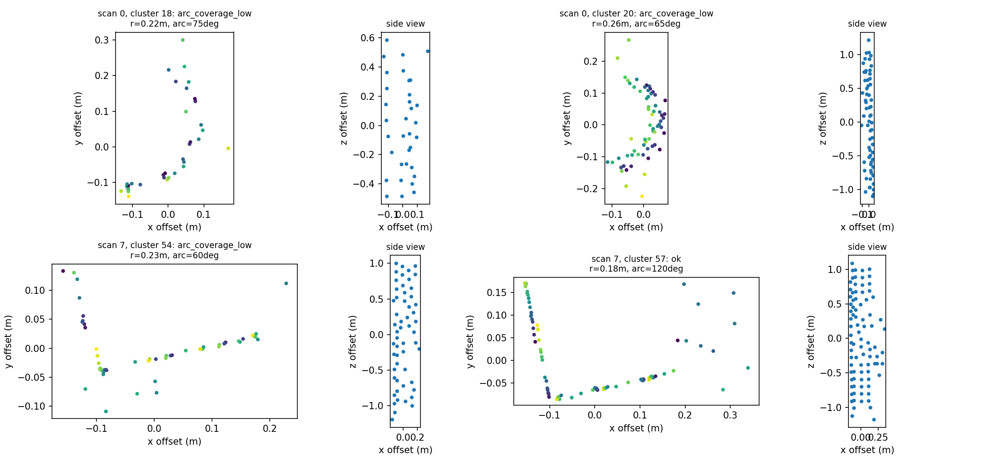

# 公園稀疏提取：分站開發與保留驗證

開發站0–15，共15個配對、seed21–25；保留站16–31，共12個配對、seed31–40；跨組4個配對排除。Park全場先前曾做整體測試，本輪分組只能視為本輪不參與調參的保留資料，不是全新森林。

## 候選檢視與方案

第0與第7站的候選群匯出後，全部分群點數及重心與舊紀錄一致。部分被拒絕群的俯視圖有圓弧、側視圖近直立；原佔格角度量法可能受稀疏度影響，但沒有語義樹木真值，不能斷言它們全是真樹。

比較7個事前列出的方案。只降低法向權重0/75、加5cm幾何容差1/75、只放寬覆蓋門檻0/75、90%角度跨度0/75；四項放寬的組合12/75最佳。新跨度量法沒有被選為最終方案。完整數字見development_summary.csv。

選定稀疏組合：法向量權重0.1→0.02；圓柱殘差容差2→5cm；佔格覆蓋100→60°；法向一致性75→50%。僅在離地高度過濾及voxel後的點間距中位數>5cm時啟用。密集輸入保留原擬合設定。Park法向半徑仍20cm、ETH仍10cm，兩者分群均20cm，未改配準求解與成功門檻。

方案於2026-10-25T09:45:10.538171+00:00固定，之後才產生保留組seed31–40；驗證結果出來後沒有重調參數。

## 結果與判斷

保留組：對照0/120，新方案2/120；補回2、退步0。只在19→18配對兩個seed成功；開發組12/75未穩定延伸到保留站點，不能把本方案視為可靠泛化。

ETH回歸：原21–30的180份樹位／分群／保留率CSV逐位元組一致；重新執行配準後300列的變換、匹配與誤差仍與原值一致，主要solver維持150/150。這確認密度分流沒有破壞原ETH行為，並不表示Park已解決。

目前不建議以新組合取代既有ETH推薦方案。公園提取仍缺乏穩定且足夠的共同柱狀候選；下一步需換提取策略或取得原始密度的森林分站資料，並建立新的獨立驗證。

## 重現與檔案

sparse_stem_study.py screen只讀開發組並保存frozen.json；validate讀保留站點；eth核對既有ETH21–30；最後執行report_sparse_stems.py。新功能在cm_sparse_extract中，原cm_extract_batch、核心預設及cm_register均未改動。

[精簡版](comparison_simple.xlsx)含結果、調參說明與保留配對；[完整版](comparison_full.xlsx)另含1050筆開發、480筆保留、300筆ETH結果與核驗。

